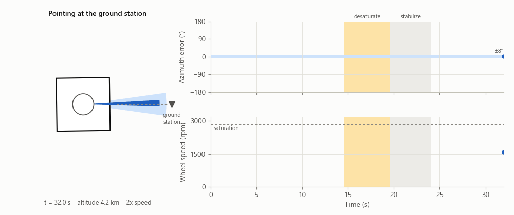
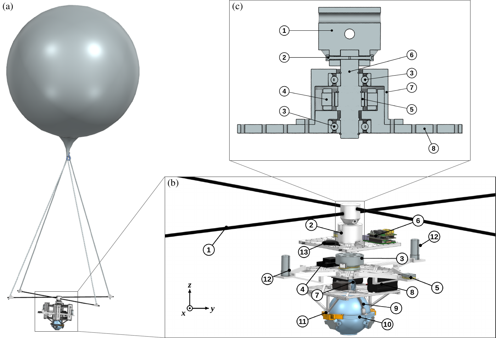
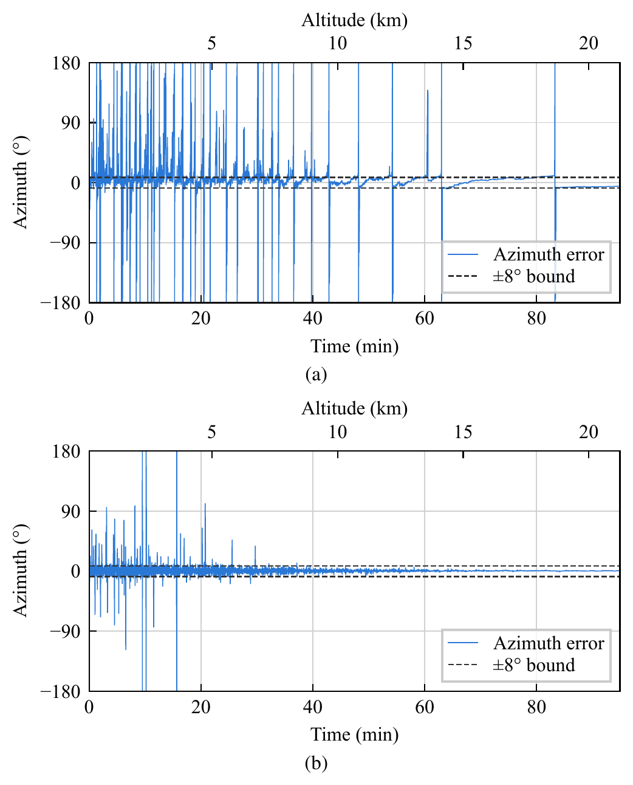
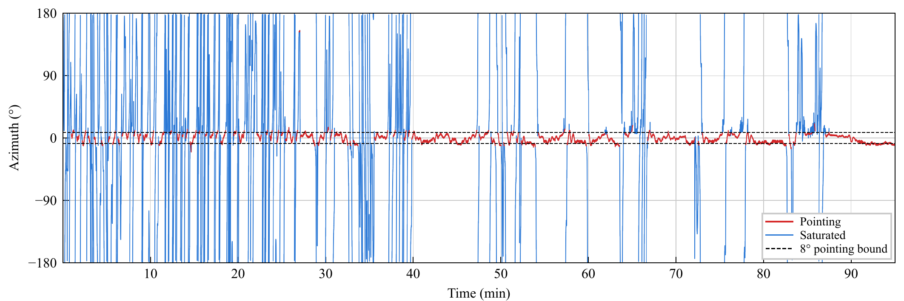

<h1 align="center">HAB ADCS Simulation</h1>

<p align="center"><b>Azimuth pointing simulation of the ALTAIR high-altitude balloon payload</b></p>

<p align="center">
  
  
  
  
  
</p>

<p align="center">
  
</p>

<p align="center"><sub>A gust saturates the momentum wheel. The flight computer spins it back down, stabilizes the payload and reacquires the ground station.</sub></p>

ALTAIR flies a calibrated light source on a high-altitude balloon as an artificial star for calibrating ground-based telescopes. The source must stay pointed at the telescope within ±8°, which keeps the flux loss from misalignment under 1%. Wind disturbances rotate the payload, and a momentum wheel counters them until a steady wind torque drives it to its speed limit. A pivot motor between the payload and the flight train transfers that momentum to the balloon so pointing is not interrupted.

This simulation models the payload's azimuth dynamics, motors, sensors and flight software at 1 ms resolution, driven by wind torque derived from flight data. It is used to design the pivot motor and is compared against the May 27, 2026 flight.

<table align="center">
  <tr>
    <td align="center" width="33%"><h3>53</h3>windows of 30 s within ±8° on Flight 2, momentum wheel only</td>
    <td align="center" width="33%"><h3>74% → 97%</h3>of a simulated ascent within ±8° once the pivot motor is added</td>
    <td align="center" width="33%"><h3>15 → 45 min</h3>longest unbroken window within ±8° in simulation</td>
  </tr>
</table>

## Payload

<p align="center"></p>

<p align="center"><sub>(a) Balloon and flight train, (b) payload, (c) pivot motor cross-section.</sub></p>

<details>
<summary><b>Figure key</b></summary>
<br>

| # | (b) Payload | (c) Pivot motor |
|---|---|---|
| 1 | Carbon-fiber rods | Rod connector |
| 2 | Pivot motor | Screw hole |
| 3 | Momentum wheel | Ball bearings |
| 4 | Pixhawk flight controller | Motor stator |
| 5 | External magnetometer | Motor rotor |
| 6 | Flight computer | Shaft |
| 7 | Servo gear motor | Motor housing |
| 8 | Batteries | Payload top deck |
| 9 | Sphere drive chain | |
| 10 | Integrating sphere | |
| 11 | Sphere mounting rig | |
| 12 | GNSS antennas | |
| 13 | Secondary GNSS | |

</details>

## Model

- **Dynamics:** rigid-body yaw with viscous damping, integrated with RK4 at 1 ms ([`integrator.py`](src/sim_tools/integrator.py))
- **Wind:** IAAFT surrogates of the yaw torque measured on a passive flight, scaled with air density along the ascent ([`wind_surrogate.py`](src/sim_tools/wind_surrogate.py))
- **Motors:** momentum wheel and pivot motor modelled as DC motors with back-EMF, current limits and friction ([`actuator.py`](src/sim_tools/actuator.py))
- **Sensors:** gyro, heading, tachometer and GNSS sampled at their flight rates with noise and bias drift ([`sensor.py`](src/sim_tools/sensor.py))
- **Flight software:** the pointing state machine ported from the flight computer, including wheel saturation and recovery ([`pointing.py`](src/sim_tools/pointing.py))
- **Monte Carlo:** dispersions on mass properties, friction, motor constants and altitude, defined in TOML and run in parallel ([`monte_carlo/`](src/hab_adcs_sim/monte_carlo))

<details>
<summary><b>Equations of motion</b></summary>
<br>

Payload azimuth and momentum wheel speed:

```math
I_p\,\ddot\alpha = \tau_w - \tau_{rw} - \tau_{pm} - c_p\,\dot\alpha,
\qquad
J_{rw}\,\dot\omega = \tau_{rw}
```

Momentum wheel, driven at the back-EMF voltage of the commanded speed:

```math
L\,\frac{di}{dt} = V - R\,i - K_b\,\omega,
\qquad
\tau_{rw} = K_t\,\mathrm{sat}(i) - b\,\omega,
\qquad
V = K_b\,\omega_{cmd}
```

Pivot motor, current commanded:

```math
\tau_{pm} = K_t\,\mathrm{sat}(i_{cmd}) + b\,\dot\alpha + \tau_c\,\mathrm{sgn}(\dot\alpha)
```

Wind torque along the ascent:

```math
\tau_w(t) = c_s\,\rho(h) + \sigma_0\left(\frac{\rho(h)}{\rho_0}\right)^{k} e^{s\eta}\,\xi(t),
\qquad
h = h_0 + \dot h\,t
```

The first term is the steady wind torque, proportional to air density. The second is the gust torque: a unit-variance IAAFT surrogate of the torque logged on the passive May 8, 2026 flight, scaled with air density and by a random factor drawn once per run. The steady torque and gust level are fitted to the May 27, 2026 flight.

</details>

## Results

<p align="center"></p>

<p align="center"><sub>Azimuth error over a simulated ascent: (a) momentum wheel only, (b) momentum wheel with the pivot motor.</sub></p>

With the momentum wheel alone, the steady wind torque saturates the wheel every few minutes at low altitude, and each recovery leaves the payload spinning. The pivot motor removes that momentum continuously.

| | Wheel only | Wheel and pivot motor |
|---|---|---|
| Ascent within ±8° | 74% | 97% |
| Longest window within ±8° | 15 min | 45 min |

The pivot motor runs use the pointing controller without the state machine, which is still in development for the two-motor system.

### Flight comparison

<p align="center"></p>

<p align="center"><sub>Azimuth during the ascent of Flight 2 (May 27, 2026), momentum wheel only. Red is pointing, blue is the wheel saturated and recovering.</sub></p>

Flight 2 flew the momentum wheel alone with the same state machine and logged 53 windows of 30 s within ±8°, with 3.7° RMS error over those windows. The simulation reproduces the saturation and recovery cycle seen in flight, but saturates less often in the second half of the ascent.

## Quick start

Requires Python 3.14 and [Poetry](https://python-poetry.org/).

```bash
git clone https://github.com/yorgoah/HAB_ADCS_SIM.git
cd HAB_ADCS_SIM
poetry install
poetry run pytest
poetry run python -m hab_adcs_sim.simulation_runner
```

A single run simulates the 95 min ascent and saves every state to `results/`. `lt_motor.activate` in [`parameters_ec60.json`](config/sim_params/parameters_ec60.json) switches the pivot motor on or off. The tests check the physics, the wind surrogates against the flight spectrum, and the state machine against the flight thresholds.

Monte Carlo campaigns are defined in [`config/campaigns/`](config/campaigns):

```bash
poetry run python -m hab_adcs_sim.monte_carlo generate config/campaigns/nominal_pivot_motor.toml
poetry run python -m hab_adcs_sim.monte_carlo run monte_carlo/nominal_pivot_motor
```

## Publication

Y. Abou Haidar, B. D'Agnillo, A. J. Higgins, J. R. Forbes and J. Albert, "Precise Azimuthal Control of a Lightweight High-Altitude Balloon Payload for Extended-Duration Flights," submitted to the 2027 IEEE Aerospace Conference.

Developed by [Yorgo Abou Haidar](https://github.com/yorgoah) for ALTAIR, a McGill University and University of Victoria project.